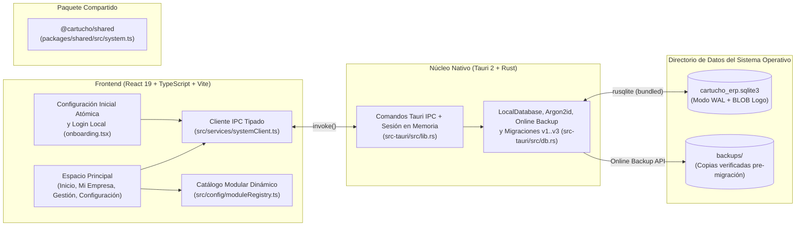

# Cartucho ERP

**Cartucho ERP** es una plataforma ERP de escritorio **local-first, modular, multiplataforma y personalizable**, diseñada para instalarse directamente en el ordenador del usuario y funcionar de forma 100% autónoma sin depender de conexión a Internet ni de servidores externos.

---

## 1. Objetivo y Alcance Actual

El proyecto cuenta con una arquitectura de escritorio completa, segura y preparada para adaptarse a distintos giros de negocio (una empresa por instalación):

- **Qué está implementado y operativo hoy:**
  - Monorepo configurado con **`pnpm workspaces`** (`apps/desktop` y `packages/shared`).
  - Aplicación de escritorio integrada con **Tauri 2**, **Rust**, **React 19**, **TypeScript 5** y **Vite 6**.
  - Motor de base de datos **SQLite 3 (`3.46.0` embebido)** gestionado desde Rust en modo `WAL` (`Write-Ahead Logging`) con integridad referencial activa (`PRAGMA foreign_keys = ON`).
  - **Respaldo automático verificado antes de migraciones:** Uso de la API nativa **Online Backup** de SQLite (`rusqlite::backup::Backup`) y verificación `PRAGMA integrity_check` en `<AppDataDir>/backups/` antes de actualizar el esquema de una base existente.
  - **Esquema versionado (`v3`):**
    - `v1`: Metadatos del sistema (`_app_metadata`), preferencias y pruebas de persistencia (`_persistence_checks`).
    - `v2`: Perfil de la única empresa de la instalación (`company_profile`, con logotipo almacenado como `BLOB` binario validado para PNG, JPEG y WEBP) y capacidades desacopladas de la instalación (`installation_entitlements` con `commercial_plan_key`, `enabled_modules_json = '[]'` y `enabled_addons_json = '[]'`).
    - `v3`: Usuarios y control de acceso local (`app_users`) con contraseñas protegidas mediante **Argon2id** (`argon2` + sal criptográfica `OsRng`).
  - **Flujo de primera ejecución atómico e Inicio de sesión local:**
    - Al iniciar por primera vez, un asistente guiado registra en una **única transacción SQLite** los datos de la empresa y la cuenta del administrador principal.
    - Todas las operaciones protegidas validan obligatoriamente la sesión activa en memoria dentro del backend Rust. Al cerrar la aplicación, la sesión finaliza y vuelve a solicitarse inicio de sesión al reabrir.
  - **Interfaz Business Minimalist rediseñada:**
    - Pantalla **Inicio** orientada al espacio de trabajo de la empresa (logotipo, nombre comercial y áreas modulares).
    - Sección **Mi empresa** para consultar y editar la ficha empresarial y su logotipo en SQLite.
    - Menú lateral categorizado (**General**, **Empresa**, **Gestión** construida dinámicamente según módulos y **Aplicación > Configuración** con submenú expandible para *Apariencia*, *Usuarios y acceso*, *Base de datos* y *Acerca de*).
    - Barras de desplazamiento discretas, barra superior limpia con controles nativos de ventana y soporte para **Tema Claro**, **Tema Oscuro** y **Sistema Operativo**.
- **Qué NO forma parte de esta etapa (Planificado para fases posteriores):**
  - Los módulos comerciales (*Inventario*, *Ventas*, *Clientes* y módulos específicos por tipo de negocio) tienen su arquitectura y navegación preparadas, pero su lista de módulos habilitados inicia vacía (`[]`) hasta su desarrollo e implementación.
  - No requiere ni implementa servicios en la nube, multiempresa dentro de una misma instalación, pasarelas de pago ni facturación electrónica fiscal.

---

## 2. Tecnologías Utilizadas

| Capa | Tecnología | Versión | Propósito |
| :--- | :--- | :--- | :--- |
| **Contenedor de Escritorio** | **Tauri** (`@tauri-apps/cli`, `@tauri-apps/api`) | `2.x` (`2.12.4`) | Empaquetado nativo multiplataforma, controles de ventana e IPC seguro |
| **Capa Nativa y Acceso a Datos** | **Rust** (`rustc` / `cargo`) | `1.99.1` (Edition 2021) | Lógica del sistema, validación de sesión, respaldos y acceso a SQLite |
| **Motor de Base de Datos** | **SQLite** (`rusqlite` con features `bundled`, `backup`) | `0.32.1` (SQLite `3.46.0`) | Base de datos relacional local y respaldos Online Backup |
| **Seguridad de Contraseñas** | **Argon2id** (`argon2`, `password-hash`) | `0.5.3` | Hashing seguro de contraseñas con sal aleatoria (`OsRng`) |
| **Interfaz de Usuario (UI)** | **React + TypeScript + Vite** | React `19.0.0`, TS `5.7.2`, Vite `6.4.6` | Interfaz de escritorio reactiva y tipada |
| **Iconografía** | **Lucide React** (`lucide-react`) | `0.468.0` | Iconografía geométrica minimalista |
| **Gestor de Paquetes** | **pnpm** (Workspaces) | `12.18.0` (compatible `>=9.0.0`) | Gestión del monorepo y dependencias |

---

## 3. Arquitectura General



---

## 4. Requisitos del Sistema

### Requisitos Comunes
- **Node.js:** `>= 20.0.0` LTS (recomendado `22.x` o `24.x`).
- **pnpm:** `>= 9.0.0`.
- **Rust:** Toolchain estable (`rustup`, `rustc`, `cargo`).

### Requisitos Nativos por Sistema Operativo
- **Windows 10 / 11:**
  - *Microsoft Visual Studio C++ Build Tools* (carga de trabajo *"Desarrollo para el escritorio con C++"*).
  - *Microsoft Edge WebView2* (incluido por defecto en Windows 10/11 actualizados).
- **Linux (Debian / Ubuntu):**
  - Paquetes de desarrollo de GTK3 y WebKit2GTK:
    `sudo apt install -y libwebkit2gtk-4.1-dev build-essential curl wget file libxdo-dev libssl-dev libayatana-appindicator3-dev librsvg2-dev pkg-config`
- **macOS:**
  - *Xcode Command Line Tools* (`xcode-select --install`).

---

## 5. Instalación de Dependencias

```bash
git clone https://github.com/Piscuish/Cartucho-ERP.git
cd Cartucho-ERP
pnpm install
```

---

## 6. Ejecución en Modo Desarrollo y Pruebas

### Ejecutar la aplicación de escritorio Tauri 2 (Ventana Nativa + SQLite)
```bash
pnpm tauri:dev
```

### Ejecutar únicamente el servidor de desarrollo Vite (Vista Previa Web)
```bash
pnpm dev
```

### Ejecutar verificaciones de tipos, compilación y pruebas de Rust/SQLite
```bash
pnpm typecheck
pnpm build
pnpm test:rust
```

---

## 7. Compilación de la Aplicación (Instalador de Escritorio)

Para generar el ejecutable y los instaladores nativos de producción (`.msi` / `.exe` en Windows, `.deb` / `.AppImage` en Linux, `.dmg` / `.app` en macOS):

```bash
pnpm tauri:build
```

Los artefactos compilados se generan en:
`apps/desktop/src-tauri/target/release/bundle/`

---

## 8. Ubicación de la Base de Datos y Copias de Seguridad según el Sistema Operativo

Cartucho ERP almacena su archivo `cartucho_erp.sqlite3` y la subcarpeta de respaldos verificados `backups/` en el directorio estándar de datos locales del usuario (resuelto mediante `directories::ProjectDirs::from("com", "cartucho", "cartucho-erp")`), nunca dentro de la carpeta de instalación ni en el repositorio Git:

| Sistema Operativo | Ruta del Archivo SQLite | Carpeta de Respaldos Automáticos |
| :--- | :--- | :--- |
| **Windows 10 / 11** | `C:\Users\<Usuario>\AppData\Local\cartucho\cartucho-erp\data\cartucho_erp.sqlite3` | `...\data\backups\` |
| **Linux** | `/home/<usuario>/.local/share/cartucho-erp/cartucho_erp.sqlite3` | `~/.local/share/cartucho-erp/backups/` |
| **macOS** | `/Users/<Usuario>/Library/Application Support/com.cartucho.cartucho-erp/cartucho_erp.sqlite3` | `.../com.cartucho.cartucho-erp/backups/` |

---

## 9. Estructura de Carpetas del Proyecto

```text
Cartucho-ERP/
├── AGENTS.md                             # Instrucciones obligatorias de protección de datos y persistencia
├── .editorconfig                         # Reglas de formato consistentes entre Windows, Linux y macOS
├── .gitattributes                        # Normalización de saltos de línea (LF / CRLF)
├── .gitignore                            # Exclusiones de Git (node_modules, target, *.sqlite3, etc.)
├── package.json                          # Scripts globales del monorepo
├── pnpm-workspace.yaml                   # Configuración de workspaces de pnpm
├── README.md                             # Documentación principal del repositorio
│
├── apps/
│   └── desktop/                          # Aplicación principal de escritorio (@cartucho/desktop)
│       ├── src/                          # Código fuente del frontend (React 19 + TypeScript)
│       │   ├── main.tsx                  # Punto de montaje de React
│       │   ├── App.tsx                   # Orquestador de configuración inicial, sesión, tema y navegación
│       │   ├── config/
│       │   │   └── moduleRegistry.ts     # Catálogo desacoplado de módulos de gestión
│       │   ├── components/
│       │   │   ├── layout.tsx            # Sidebar categorizado con submenús, Topbar con controles de ventana y Statusbar
│       │   │   ├── onboarding.tsx        # Configuración inicial atómica (Empresa + Admin) y Pantalla de Login
│       │   │   ├── ui.tsx                # Componentes reutilizables Business Minimalist
│       │   │   └── views.tsx             # Vistas: Inicio, Mi empresa, Módulos en planificación y Configuración (4 secciones)
│       │   ├── services/
│       │   │   └── systemClient.ts       # Cliente tipado de comunicación con los comandos IPC de Tauri
│       │   └── styles/
│       │       └── theme.css             # Tokens semánticos Business Minimalist (Light + Dark) y barras de scroll discretas
│       │
│       └── src-tauri/                    # Núcleo nativo de escritorio (Tauri 2 + Rust + SQLite)
│           ├── Cargo.toml                # Manifiesto Rust (tauri, rusqlite bundled+backup, argon2, base64, serde)
│           ├── tauri.conf.json           # Configuración de ventana, seguridad y bundle de Tauri 2
│           ├── capabilities/
│           │   └── default.json          # Permisos nativos de Tauri 2 (core + controles de ventana)
│           └── src/
│               ├── db.rs                 # Gestor SQLite, respaldos Online Backup, migraciones v1..v3, Argon2id y tests
│               ├── lib.rs                # Estado compartido AppState y comandos IPC #[tauri::command]
│               └── main.rs               # Punto de entrada del binario nativo
│
├── packages/
│   └── shared/                           # Paquete compartido de contratos (@cartucho/shared)
│       └── src/
│           ├── index.ts
│           └── system.ts                 # Tipos e interfaces compartidas entre React y Rust
│
└── docs/                                 # Documentación técnica detallada
    ├── README.md
    ├── 01-architecture/
    ├── 02-database/
    ├── 03-requirements/
    ├── 04-coding-standards/
    ├── 05-roadmap/
    └── 06-setup/
```
