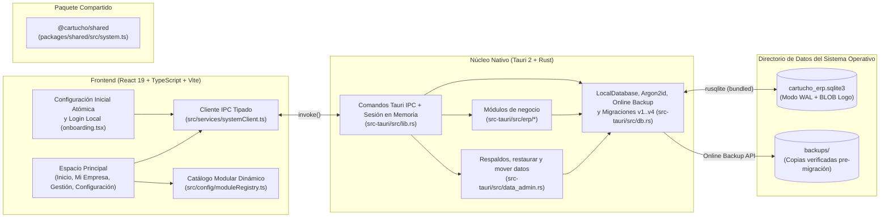

# Cartucho ERP

**Cartucho ERP** es una plataforma ERP de escritorio **local-first, modular, multiplataforma y personalizable**, diseñada para instalarse directamente en el ordenador del usuario y funcionar de forma 100% autónoma sin depender de conexión a Internet ni de servidores externos.

---

## 1. Qué hace hoy

Programa de **facturación y gestión para pequeñas empresas**. Funciona sin Internet: toda la información queda en un archivo SQLite en el equipo.

| Área | Funciones |
| :--- | :--- |
| **Acceso** | Asistente de primera ejecución (empresa, logo, administrador y contraseña) y pantalla de inicio de sesión con el logo y el nombre de la empresa. Contraseñas con Argon2id; bloqueo de 30 s tras 5 intentos fallidos. |
| **Inicio** | Ventas, dinero recibido, gastos y balance del mes; ingresos vs. gastos (6 meses); facturas vencidas; stock bajo; más vendidos; accesos rápidos. |
| **Facturas** | Editor con buscador de productos, líneas libres, notas, condiciones y pie de página; pago inicial opcional; historial con filtros; abonos (pagos parciales); anulación con motivo (no se borra, devuelve inventario); impresión en **Carta, Media carta, A4 y tirilla térmica de 80 mm o 58 mm** (o «Guardar como PDF»). |
| **Cotizaciones** | Se imprimen igual que las facturas y se convierten en factura con un clic. |
| **Clientes** | Directorio con total comprado y saldo pendiente; archivar sin perder historial. |
| **Catálogo** | Productos y servicios con foto de referencia, descripción, precio, costo, margen y categorías. |
| **Inventario** | Existencias, compras (opcionalmente registradas como gasto), ajustes por conteo y movimientos. |
| **Finanzas** | Ventas, dinero recibido, gastos operativos (arriendo, luz, internet, nómina…), compras de inventario, balance de caja, ganancia bruta estimada, gráficos y exportación CSV para Excel. |
| **Datos** | Exportar copia (por ejemplo, a una USB), crear respaldo, restaurar, mover la carpeta de datos, usar una carpeta traída de otro equipo y respaldo automático diario. |
| **Usuarios y roles** | Varios usuarios por instalación. El administrador crea roles (Vendedor, Solo consulta o propios) eligiendo por módulo «Ver» o «Ver y editar», solo entre los módulos de la licencia. |
| **Licencias y módulos** | Activación con clave `CE-XXXX-…` o código sin Internet; cada licencia define módulos (Básico, Tienda, Completo o personalizado) y equipos (1 a 5). Valida cada hora y funciona 30 días sin Internet. Si se desactiva, solo permite ver facturas y el inicio muestra «Contacta a soporte». Servidor y panel en `license-server/` (ver su README). |
| **Interfaz** | Estilo «lateral oscuro» con acento violeta, tema claro/oscuro, menú colapsable (Ctrl+B) y búsqueda rápida (Ctrl+K). |

**Fuera del alcance actual:** facturación electrónica DIAN e impuestos (las facturas son documentos internos), varios usuarios con roles, trabajo en red local y nube. La arquitectura está preparada para red local y nube (ver `docs/01-architecture/adr/0003-lan-and-cloud-readiness.md`).

### Actualizar desde la versión anterior

1. Cierra la aplicación.
2. En la carpeta del proyecto ejecuta `pnpm install` (hay dependencias nuevas: tipografía Inter local y diálogos nativos).
3. Ejecuta `pnpm tauri:dev` o `pnpm tauri:build`.
4. Al abrir, la base de datos pasa de la versión 3 a la 4. Antes de cambiar nada se crea automáticamente un respaldo verificado en `backups/cartucho_erp_pre_migration_v3_to_v4_*.sqlite3`. Tus datos (empresa, logo y usuario) se conservan.

### Vista previa en el navegador

`pnpm dev` abre la interfaz en `http://localhost:1420` con un backend de demostración que guarda datos en el navegador (no en SQLite). Para cargar datos de ejemplo, abre la consola del navegador y ejecuta `__cartuchoDemo()` (usuario `admin`, contraseña `demo1234`).

Para ver cómo queda cada licencia: `__cartuchoLicencia("restricted")`, `__cartuchoLicencia("unlicensed")`, `__cartuchoLicencia("licensed", ["invoices", "customers"])` o `__cartuchoLicencia("dev")`.

---

## 2. Tecnologías Utilizadas

| Capa | Tecnología | Versión | Propósito |
| :--- | :--- | :--- | :--- |
| **Contenedor de Escritorio** | **Tauri** (`@tauri-apps/cli`, `@tauri-apps/api`) | `2.x` (`2.12.4`) | Empaquetado nativo multiplataforma, controles de ventana e IPC seguro |
| **Capa Nativa y Acceso a Datos** | **Rust** (`rustc` / `cargo`) | `1.99.1` (Edition 2021) | Lógica del sistema, validación de sesión, respaldos y acceso a SQLite |
| **Motor de Base de Datos** | **SQLite** (`rusqlite` con features `bundled`, `backup`) | `0.32.1` (SQLite `3.46.0`) | Base de datos relacional local y respaldos Online Backup |
| **Seguridad de Contraseñas** | **Argon2id** (`argon2`, `password-hash`) | `0.5.3` | Hashing seguro de contraseñas con sal aleatoria (`OsRng`) |
| **Interfaz de Usuario (UI)** | **React + TypeScript + Vite** | React `19.0.0`, TS `5.7.2`, Vite `6.4.6` | Interfaz de escritorio reactiva y tipada |
| **Iconografía** | **Lucide React** (`lucide-react`) | `0.468.0` | Iconografía geométrica minimalista |
| **Diálogos nativos** | `tauri-plugin-dialog` / `@tauri-apps/plugin-dialog` | `2.x` | Elegir carpetas y archivos para respaldos y exportaciones |
| **Tipografía** | `@fontsource-variable/inter` | `5.x` | Fuente Inter incluida en la app (funciona sin Internet) |
| **Gestor de Paquetes** | **pnpm** (Workspaces) | `12.18.0` (compatible `>=9.0.0`) | Gestión del monorepo y dependencias |

---

## 3. Arquitectura General



---

## 4. Requisitos del Sistema

### Requisitos Comunes
- **Node.js:** `>= 20.0.0` LTS (recomendado `22.x` o `24.x`).
- **pnpm:** `>= 9.0.0`.
- **Rust:** Toolchain estable (`rustup`, `rustc`, `cargo`).

### Requisitos Nativos por Sistema Operativo
- **Windows 10 / 11:**
  - *Microsoft Visual Studio C++ Build Tools* (carga de trabajo *"Desarrollo para el escritorio con C++"*).
  - *Microsoft Edge WebView2* (incluido por defecto en Windows 10/11 actualizados).
- **Linux (Debian / Ubuntu):**
  - Paquetes de desarrollo de GTK3 y WebKit2GTK:
    `sudo apt install -y libwebkit2gtk-4.1-dev build-essential curl wget file libxdo-dev libssl-dev libayatana-appindicator3-dev librsvg2-dev pkg-config`
- **macOS:**
  - *Xcode Command Line Tools* (`xcode-select --install`).

---

## 5. Instalación de Dependencias

```bash
git clone https://github.com/Piscuish/Cartucho-ERP.git
cd Cartucho-ERP
pnpm install
```

---

## 6. Ejecución en Modo Desarrollo y Pruebas

### Ejecutar la aplicación de escritorio Tauri 2 (Ventana Nativa + SQLite)
```bash
pnpm tauri:dev
```

### Ejecutar únicamente el servidor de desarrollo Vite (Vista Previa Web)
```bash
pnpm dev
```

### Ejecutar verificaciones de tipos, compilación y pruebas de Rust/SQLite
```bash
pnpm typecheck
pnpm build
pnpm test:rust
```

---

## 7. Instalador de Windows y actualizaciones

**Instalador liviano (NSIS):** se instala solo para el usuario (sin pedir administrador), en español, con
accesos en el escritorio y el menú Inicio; al terminar abre el programa y arranca el asistente:
base de datos → empresa → logotipo → impresión → administrador.

**Cómo se arma:** GitHub lo compila en una máquina Windows (`.github/workflows/release.yml`).

1. Sube la versión en `apps/desktop/src-tauri/tauri.conf.json` (y `Cargo.toml` / `package.json`).
2. Crea y sube una etiqueta: `git tag v0.3.1 && git push origin v0.3.1` (o pulsa *Run workflow* en la pestaña Actions).
3. En unos 15 minutos aparece en **Releases** el archivo `Cartucho ERP_X.Y.Z_x64-setup.exe` y `latest.json`.

**Actualizaciones automáticas:** el programa consulta
`https://github.com/Piscuish/Cartucho-ERP/releases/latest/download/latest.json` al abrir y cada 6 horas
(solo el administrador ve el aviso). Cada actualización va firmada; antes de instalar se hace una copia
de seguridad y la base se migra con su respaldo verificado. Para firmar, agrega en GitHub
(*Settings › Secrets and variables › Actions*) los secretos `TAURI_SIGNING_PRIVATE_KEY` y
`TAURI_SIGNING_PRIVATE_KEY_PASSWORD`. Sin ellos el instalador se publica igual, sin archivos de actualización.

> ⚠️ Guarda la clave privada de actualizaciones en un lugar seguro. Si se pierde, los programas ya
> instalados no aceptarán actualizaciones firmadas con otra clave (habría que reinstalar).

**Licencias:** sin `LICENSE_PUBLIC_KEY` (variable de GitHub o `license_public_key.txt`) el instalador funciona
con todos los módulos. Al configurarla, el instalador exige licencia y el token trae los datos de la
empresa, que llenan solo el asistente inicial (ver `license-server/README.md`).

Compilar a mano en un PC con Windows: `pnpm tauri:build` (artefactos en `apps/desktop/src-tauri/target/release/bundle/`).

---

## 8. Ubicación de la Base de Datos y Copias de Seguridad según el Sistema Operativo

Cartucho ERP almacena su archivo `cartucho_erp.sqlite3` y la subcarpeta de respaldos verificados `backups/` en el directorio estándar de datos locales del usuario (resuelto mediante `directories::ProjectDirs::from("com", "cartucho", "cartucho-erp")`), nunca dentro de la carpeta de instalación ni en el repositorio Git:

| Sistema Operativo | Ruta del Archivo SQLite | Carpeta de Respaldos Automáticos |
| :--- | :--- | :--- |
| **Windows 10 / 11** | `C:\Users\<Usuario>\AppData\Local\cartucho\cartucho-erp\data\cartucho_erp.sqlite3` | `...\data\backups\` |
| **Linux** | `/home/<usuario>/.local/share/cartucho-erp/cartucho_erp.sqlite3` | `~/.local/share/cartucho-erp/backups/` |
| **macOS** | `/Users/<Usuario>/Library/Application Support/com.cartucho.cartucho-erp/cartucho_erp.sqlite3` | `.../com.cartucho.cartucho-erp/backups/` |

---

## 9. Estructura de Carpetas del Proyecto

```text
Cartucho-ERP/
├── AGENTS.md                        # Reglas obligatorias de protección de datos
├── apps/desktop/
│   ├── src/                         # Interfaz (React 19 + TypeScript)
│   │   ├── App.tsx                  # Arranque, asistente, login, tema y navegación
│   │   ├── components/              # layout (menú y Ctrl+K), onboarding, ui, print, charts, categories, views
│   │   ├── pages/                   # Dashboard, Invoices, InvoiceDetail, DocumentEditor, Quotes,
│   │   │                            # Customers, Catalog, Inventory, Finance, Expenses, Settings
│   │   ├── config/moduleRegistry.ts # Menú lateral y rutas
│   │   ├── services/systemClient.ts # Cliente tipado de comandos Tauri
│   │   ├── services/previewBackend.ts # Backend de demostración para `pnpm dev`
│   │   ├── lib/                     # Formatos (pesos, fechas), hooks e imágenes
│   │   └── styles/theme.css         # Sistema visual «lateral oscuro» (claro y oscuro)
│   └── src-tauri/src/
│       ├── db.rs                    # Conexión, migraciones v1..v4, sesión y empresa
│       ├── data_admin.rs            # Exportar, restaurar, mover datos, respaldo diario
│       ├── erp/                     # customers, catalog (productos e inventario), sales
│       │                            # (facturas, pagos, cotizaciones), finance, settings, tests
│       ├── lib.rs                   # Comandos IPC
│       └── main.rs
├── packages/shared/src/             # Contratos compartidos (system.ts, erp.ts)
└── docs/                            # Arquitectura, base de datos, requisitos, roadmap
```
