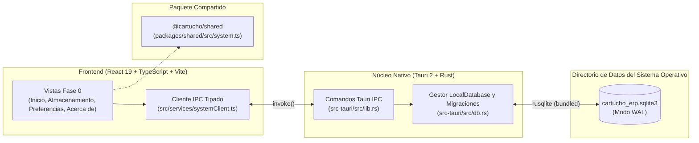

# Cartucho ERP

**Cartucho ERP** es una plataforma ERP de escritorio **local-first, modular, multiplataforma y personalizable**, diseñada para instalarse directamente en el ordenador del usuario y funcionar de forma 100% autónoma sin depender de conexión a Internet ni de servidores externos.

---

## 1. Objetivo y Alcance Actual (Fase 0 Completada)

En su estado actual (**Fase 0 — Fundación Local-First**), el proyecto establece los cimientos arquitectónicos, de persistencia y de interfaz visual sobre los que se construirán progresivamente los módulos del ERP:

- **Qué está implementado y operativo hoy:**
  - Monorepo configurado con **`pnpm workspaces`** (`apps/desktop` y `packages/shared`).
  - Aplicación de escritorio integrada con **Tauri 2**, **Rust**, **React 19**, **TypeScript 5** y **Vite 6**.
  - Motor de base de datos **SQLite 3 (`3.46.0` embebido)** gestionado desde Rust en modo `WAL` (`Write-Ahead Logging`) con integridad referencial activa (`PRAGMA foreign_keys = ON`).
  - Resolución automática del directorio de datos de aplicación nativo del sistema operativo (fuera de la carpeta de instalación y del repositorio Git).
  - Sistema transaccional de **migraciones de esquema** (`_schema_migrations`) y tablas técnicas iniciales (`_app_metadata` y `_persistence_checks`).
  - Comunicación tipada **React ↔ Tauri IPC (`invoke`)** para consultar el estado real del sistema, registrar pruebas de persistencia en SQLite y guardar preferencias de usuario.
  - Interfaz de escritorio completa bajo la identidad visual **Business Minimalist** con soporte para **Tema Claro**, **Tema Oscuro** y **Tema del Sistema Operativo**, persistiendo la elección en SQLite entre reinicios.
- **Qué NO forma parte de la Fase 0 (Planificado para fases posteriores):**
  - Aún no se incluyen módulos comerciales (clientes, productos, inventario, ventas, compras ni contabilidad).
  - No requiere ni implementa servicios en la nube, sincronización remota, pasarelas de pago ni facturación electrónica fiscal (DIAN).

---

## 2. Tecnologías Utilizadas

| Capa | Tecnología | Versión | Propósito |
| :--- | :--- | :--- | :--- |
| **Contenedor de Escritorio** | **Tauri** (`@tauri-apps/cli`, `@tauri-apps/api`) | `2.x` (`2.12.4`) | Empaquetado nativo multiplataforma e IPC seguro |
| **Capa Nativa y Acceso a Datos** | **Rust** (`rustc` / `cargo`) | `1.99.1` (Edition 2021) | Lógica del sistema, gestión de archivos y acceso a SQLite |
| **Motor de Base de Datos** | **SQLite** (`rusqlite` con feature `bundled`) | `0.32.1` (SQLite `3.46.0`) | Base de datos relacional local por instalación |
| **Interfaz de Usuario (UI)** | **React + TypeScript + Vite** | React `19.0.0`, TS `5.7.2`, Vite `6.4.6` | Interfaz de escritorio reactiva y tipada |
| **Iconografía** | **Lucide React** (`lucide-react`) | `0.468.0` | Iconografía geométrica minimalista |
| **Gestor de Paquetes** | **pnpm** (Workspaces) | `12.18.0` (compatible `>=9.0.0`) | Gestión del monorepo y dependencias |

---

## 3. Arquitectura General



---

## 4. Requisitos del Sistema

### Requisitos Comunes
- **Node.js:** `>= 20.0.0` LTS (recomendado `22.x` o `24.x`).
- **pnpm:** `>= 9.0.0`.
- **Rust:** Toolchain estable (`rustup`, `rustc`, `cargo`).

### Requisitos Nativos por Sistema Operativo
- **Windows 10 / 11:**
  - *Microsoft Visual Studio C++ Build Tools* (carga de trabajo *"Desarrollo para el escritorio con C++"*).
  - *Microsoft Edge WebView2* (incluido por defecto en Windows 10/11 actualizados).
- **Linux (Debian / Ubuntu):**
  - Paquetes de desarrollo de GTK3 y WebKit2GTK:
    `sudo apt install -y libwebkit2gtk-4.1-dev build-essential curl wget file libxdo-dev libssl-dev libayatana-appindicator3-dev librsvg2-dev pkg-config`
- **macOS:**
  - *Xcode Command Line Tools* (`xcode-select --install`).

---

## 5. Instalación de Dependencias

```bash
git clone https://github.com/Piscuish/Cartucho-ERP.git
cd Cartucho-ERP
pnpm install
```

---

## 6. Ejecución en Modo Desarrollo

### Ejecutar la aplicación de escritorio Tauri 2 (Ventana Nativa + SQLite)
```bash
pnpm tauri:dev
```

### Ejecutar únicamente el servidor de desarrollo Vite (Vista Previa Web)
```bash
pnpm dev
```

### Ejecutar verificaciones de tipos, compilación y pruebas de Rust/SQLite
```bash
pnpm typecheck
pnpm build
pnpm test:rust
```

---

## 7. Compilación de la Aplicación (Instalador de Escritorio)

Para generar el ejecutable y los instaladores nativos de producción (`.msi` / `.exe` en Windows, `.deb` / `.AppImage` en Linux, `.dmg` / `.app` en macOS):

```bash
pnpm tauri:build
```

Los artefactos compilados se generan en:
`apps/desktop/src-tauri/target/release/bundle/`

---

## 8. Ubicación de la Base de Datos según el Sistema Operativo

Cartucho ERP almacena su archivo `cartucho_erp.sqlite3` en el directorio estándar de datos locales del usuario (resuelto mediante `directories::ProjectDirs::from("com", "cartucho", "cartucho-erp")`), nunca dentro de la carpeta de instalación ni en el repositorio Git:

| Sistema Operativo | Ruta del Archivo SQLite |
| :--- | :--- |
| **Windows 10 / 11** | `C:\Users\<Usuario>\AppData\Local\cartucho\cartucho-erp\data\cartucho_erp.sqlite3` |
| **Linux** | `/home/<usuario>/.local/share/cartucho-erp/cartucho_erp.sqlite3` |
| **macOS** | `/Users/<Usuario>/Library/Application Support/com.cartucho.cartucho-erp/cartucho_erp.sqlite3` |

---

## 9. Estructura de Carpetas del Proyecto

```text
Cartucho-ERP/
├── .editorconfig                         # Reglas de formato consistentes entre Windows, Linux y macOS
├── .gitattributes                        # Normalización de saltos de línea (LF / CRLF)
├── .gitignore                            # Exclusiones de Git (node_modules, target, *.sqlite3, etc.)
├── .github/
│   └── pull_request_template.md          # Plantilla de verificación para Pull Requests
├── package.json                          # Scripts globales del monorepo
├── pnpm-workspace.yaml                   # Configuración de workspaces de pnpm
├── README.md                             # Documentación principal del repositorio
│
├── apps/
│   └── desktop/                          # Aplicación principal de escritorio (@cartucho/desktop)
│       ├── index.html                    # Entrada HTML de Vite
│       ├── package.json                  # Dependencias y scripts de @cartucho/desktop
│       ├── tsconfig.json                 # Configuración TypeScript estricta del frontend
│       ├── vite.config.ts                # Configuración de Vite sincronizada con Tauri 2 (puerto 1420)
│       ├── src/                          # Código fuente del frontend (React 19 + TypeScript)
│       │   ├── main.tsx                  # Punto de montaje de React
│       │   ├── App.tsx                   # Orquestador de estado, tema persistente y navegación
│       │   ├── vite-env.d.ts             # Tipos de entorno Vite
│       │   ├── components/
│       │   │   ├── layout.tsx            # Sidebar, Topbar y Statusbar de escritorio
│       │   │   ├── ui.tsx                # Componentes reutilizables (Button, Input, Select, Card, Badge, Table, Dialog, Toast, States)
│       │   │   └── views.tsx             # Vistas de Fase 0 (Inicio, Almacenamiento, Preferencias, Acerca de)
│       │   ├── services/
│       │   │   └── systemClient.ts       # Cliente tipado de comunicación con los comandos IPC de Tauri
│       │   └── styles/
│       │       └── theme.css             # Tokens semánticos Business Minimalist (Light + Dark) y estilos base
│       │
│       └── src-tauri/                    # Núcleo nativo de escritorio (Tauri 2 + Rust + SQLite)
│           ├── Cargo.toml                # Manifiesto de dependencias Rust (tauri, rusqlite bundled, serde, directories)
│           ├── Cargo.lock                # Versiones exactas bloqueadas de crates de Rust
│           ├── build.rs                  # Script de construcción de Tauri 2
│           ├── tauri.conf.json           # Configuración de ventana, seguridad y bundle de Tauri 2
│           ├── capabilities/
│           │   └── default.json          # Permisos nativos de Tauri 2 (core:default)
│           ├── icons/                    # Iconos multiplataforma (.png, .ico, .icns)
│           └── src/
│               ├── db.rs                 # Gestor SQLite local, migraciones, preferencias y pruebas unitarias
│               ├── lib.rs                # Estado compartido AppState y comandos #[tauri::command]
│               └── main.rs               # Punto de entrada del binario nativo
│
├── packages/
│   └── shared/                           # Paquete compartido de contratos (@cartucho/shared)
│       ├── package.json
│       ├── tsconfig.json
│       └── src/
│           ├── index.ts                  # Exportación principal
│           └── system.ts                 # Tipos e interfaces compartidas (SystemOverview, DatabaseStatusReport, etc.)
│
└── docs/                                 # Documentación técnica detallada
    ├── README.md                         # Índice maestro de la documentación
    ├── 01-architecture/                  # Arquitectura técnica, IPC, evolución futura y ADRs
    ├── 02-database/                      # Administración de SQLite, migraciones y ubicación de datos
    ├── 03-requirements/                  # Visión del producto, alcance, diseño visual y requisitos
    ├── 04-coding-standards/              # Estándares de código y flujo de trabajo Git
    ├── 05-roadmap/                       # Hoja de ruta evolutiva por fases
    └── 06-setup/                         # Guía detallada de instalación y compilación en Windows, Linux y macOS
```
