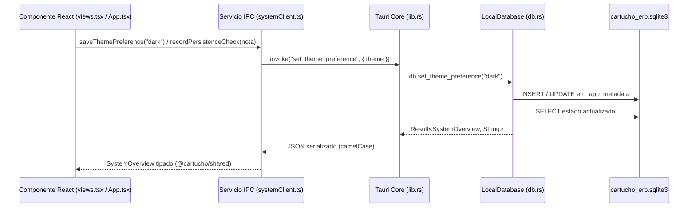

# Arquitectura Técnica, Monorepo, Tauri/Rust e Integración IPC

## 1. Arquitectura Local-First de Escritorio

**Cartucho ERP** se construye como una aplicación de escritorio autónoma (*Local-First*). Cada usuario o empresa cuenta con su propia instalación y su propia base de datos **SQLite** almacenada localmente en el equipo, funcionando al 100% sin necesidad de conexión a Internet ni servidores externos.

---

## 2. Estructura del Monorepo (`pnpm workspaces`)

El repositorio utiliza `pnpm workspaces` (definido en `pnpm-workspace.yaml`) con dos proyectos activos en la Fase 0:

1. **`packages/shared` (`@cartucho/shared`):**
   - Contiene exclusivamente los contratos TypeScript (`SystemOverview`, `DatabaseStatusReport`, `AppPreferences`, `MigrationRecord`, `PersistenceCheckRecord`) y el diccionario de nombres de comandos IPC (`TAURI_COMMANDS`).
   - Evita la duplicación o desincronización de tipos entre el frontend y el puente nativo.
2. **`apps/desktop` (`@cartucho/desktop`):**
   - Contiene el frontend en `src/` (React 19 + TypeScript + Vite) y el núcleo nativo de escritorio en `src-tauri/` (Tauri 2 + Rust + SQLite).

---

## 3. Funcionamiento de Tauri 2 y el Núcleo Rust (`src-tauri/`)

La capa nativa en Rust se organiza en tres archivos fuente dentro de `apps/desktop/src-tauri/src/`:

1. **`db.rs` (`LocalDatabase`):**
   - Resuelve el directorio de datos de aplicación del sistema operativo mediante `directories::ProjectDirs::from("com", "cartucho", "cartucho-erp")`.
   - Abre y administra la conexión con SQLite mediante `rusqlite` (`bundled`), activando `PRAGMA journal_mode = WAL`, `PRAGMA foreign_keys = ON` y `PRAGMA synchronous = NORMAL`.
   - Ejecuta automáticamente el sistema de migraciones (`_schema_migrations`) y mantiene los metadatos de ciclo de vida y preferencias (`_app_metadata`) y la tabla técnica de verificación (`_persistence_checks`).
2. **`lib.rs` (`AppState` y comandos `#[tauri::command]`):**
   - Envuelve la instancia de `LocalDatabase` dentro de `AppState { db: Mutex<LocalDatabase> }` para garantizar acceso seguro entre hilos.
   - Registra en `tauri::Builder` los comandos IPC invocables desde React.
3. **`main.rs`:**
   - Punto de entrada del ejecutable nativo. Cuando se compila con la feature `desktop-tauri` (usada por `pnpm tauri:dev` y `pnpm tauri:build`), lanza la ventana gráfica de Tauri; cuando se ejecuta como binario de diagnóstico en consola, permite verificar la creación de SQLite, la inserción de pruebas (`--record-check`) y el cambio de tema (`--set-theme`).

---

## 4. Integración de React con los Comandos IPC de Tauri

La comunicación entre la interfaz React y el núcleo Rust sigue un flujo unidireccional y tipado a través de `apps/desktop/src/services/systemClient.ts`:

### Comandos IPC Implementados en la Fase 0

| Comando Tauri (`TAURI_COMMANDS`) | Argumentos | Retorno | Función |
| :--- | :--- | :--- | :--- |
| `get_system_overview` | Ninguno | `SystemOverview` | Obtiene el estado real de la aplicación, preferencias de tema y reporte técnico de SQLite. |
| `record_persistence_check` | `{ note: string }` | `SystemOverview` | Valida e inserta un registro de prueba en `_persistence_checks` y devuelve el estado actualizado. |
| `set_theme_preference` | `{ theme: "light" \| "dark" \| "system" }` | `SystemOverview` | Guarda la preferencia de tema en `_app_metadata` dentro de SQLite y devuelve el estado actualizado. |
